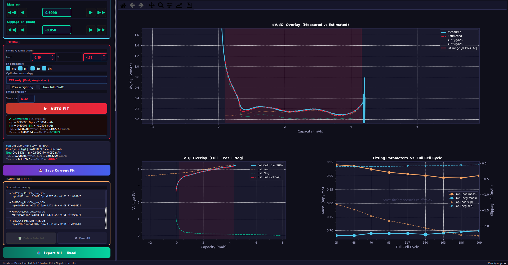
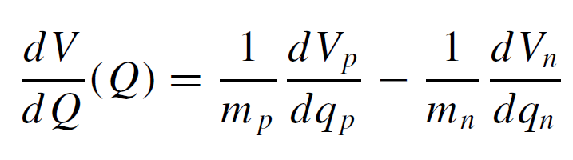
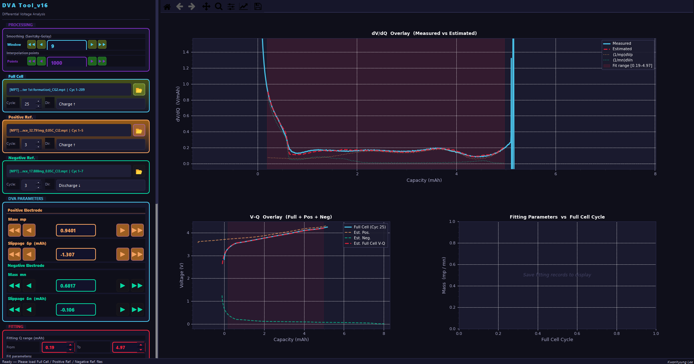

# DVA Tool — Differential Voltage Analysis for Li-ion Batteries

A desktop GUI for **differential voltage analysis (dV/dQ, DVA)** of lithium-ion full cells.
The tool reconstructs the full-cell dV/dQ curve from positive and negative half-cell reference data, fits the electrode-specific parameters (active mass and slippage), and tracks how these parameters evolve over cycling. This allows degradation to be separated into **loss of lithium inventory (LLI)** and **loss of active material (LAM)** of each electrode.



---

## Principle

The full-cell differential voltage is expressed as the difference of the two electrode contributions:



- **m<sub>p</sub>, m<sub>n</sub>** — scaling factors (active mass) of the positive / negative electrode → changes indicate **LAM**
- **δ<sub>p</sub>, δ<sub>n</sub>** — slippage (relative shift) of each electrode on the capacity axis → changes indicate **LLI**

The method follows H. M. Dahn *et al.*, *J. Electrochem. Soc.* **159** (9), A1405–A1409 (2012).

## Workflow

| Stage | Steps |
|---|---|
| **Data preparation** | Load full cell, positive reference and negative reference data → remove rest and CV segments |
| **Data processing** | Interpolation → smoothing (Savitzky–Golay filter) → numerical differentiation |
| **Fitting** | Estimate the full-cell dV/dQ from (m<sub>p</sub>, m<sub>n</sub>, δ<sub>p</sub>, δ<sub>n</sub>) → least-squares fitting within a selected capacity window |
| **Automation** | Change the full-cell cycle and repeat → plot parameter trends vs. cycle number → export |

## Features

- **Input formats:** EC-Lab `.mpt` (BioLogic BCS cycler, read directly), Excel (`.xlsx`, `.xls`), CSV / TSV / TXT
- **Three-panel view:** dV/dQ overlay (measured vs. estimated), V–Q overlay (full cell, positive and negative), and fitting parameters vs. full-cell cycle
- **Manual fitting:** adjust m<sub>p</sub>, m<sub>n</sub>, δ<sub>p</sub>, δ<sub>n</sub> with step buttons and see the estimated curve update in real time
- **Auto fitting** (`scipy.optimize.least_squares`, Trust Region Reflective):
  - *TRF only* — fast, single start
  - *Multi-start + TRF* — grid scan of initial values, then TRF (higher precision)
  - Choice of which parameters to fit, optional peak weighting, adjustable tolerance
- **Fit quality report:** RMS, MAE, maximum error, R²
- **Record management:** save fits per cycle, delete or clear records, export all results to Excel

## Installation

Requires Python 3.8 or later.

**Option 1: Anaconda (recommended)**

1. Install [Anaconda](https://www.anaconda.com/download).
2. Open *Anaconda Prompt* and run:

```bash
conda install pyqt matplotlib scipy pandas numpy openpyxl -y
```

**Option 2: pip**

```bash
pip install -r requirements.txt
```

## Usage

```bash
cd "path/to/this/folder"
python dvdq_gui.py
```



1. **File input**
   - Set the smoothing window. It depends on how dense your data points are; 1000 is usually acceptable.
   - Load the **Full Cell**, **Positive Ref.** and **Negative Ref.** data files.
   - For each file, select the cycle number and the profile (charge or discharge).
2. **Fitting**
   - Set initial values of m<sub>p</sub>, m<sub>n</sub>, δ<sub>p</sub>, δ<sub>n</sub> so that the *Estimated* curve (red dashed line) roughly matches the *Measured* curve (light blue line) in the dV/dQ plot.
   - Set the fitting Q range (shown as a transparent red box). Only data inside this window are used in the fit.
   - Select an optimization strategy. Start with **TRF only**, then switch to **Multi-start + TRF** for higher precision.
   - Click **▶ AUTO FIT**.
   - Click **💾 Save Current Fit** to store the result temporarily.
3. **Repeat for other cycles.** Move to the next full-cell cycle and repeat step 2. The saved records are plotted in the *Fitting Parameters vs. Full Cell Cycle* panel.
4. **Data export.** Click **📤 Export All → Excel** to export all saved records.

## Notes

- `.mpt` files from BioLogic cyclers are read directly. For other cycler formats, export the data to Excel or CSV (capacity and voltage columns), or adapt the loader functions in the code.
- The smoothing window and fitting range strongly affect the result. Check the dV/dQ overlay visually before saving each fit.

## Citation

If you use this tool in your research, please cite:

```
K.-H. Lee, DVA Tool: GUI software for differential voltage analysis of lithium-ion batteries (v1.0.0), GitHub, 2026. https://github.com/<username>/<repository>
```

and the original DVA method:

```
H. M. Dahn, A. J. Smith, J. C. Burns, D. A. Stevens, J. R. Dahn, "User-Friendly Differential Voltage Analysis Freeware for the Analysis of Degradation Mechanisms in Li-Ion Batteries", J. Electrochem. Soc. 159 (9), A1405–A1409 (2012).
```

## Author

**Kwon-Hyung Lee**
Developed at the Nanomanufacturing Group, University of Cambridge. Now maintained at Tech University of Korea.

## License

Released under the [MIT License](LICENSE).
